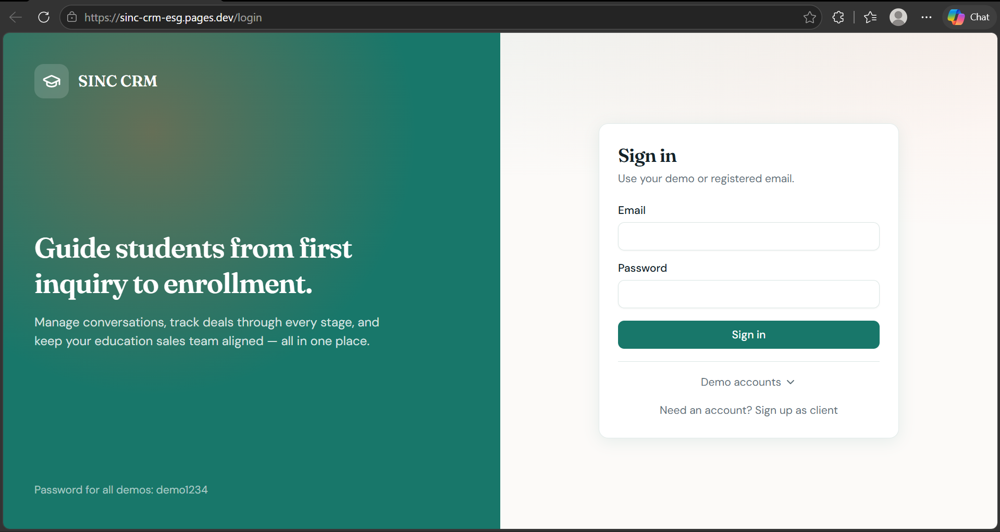
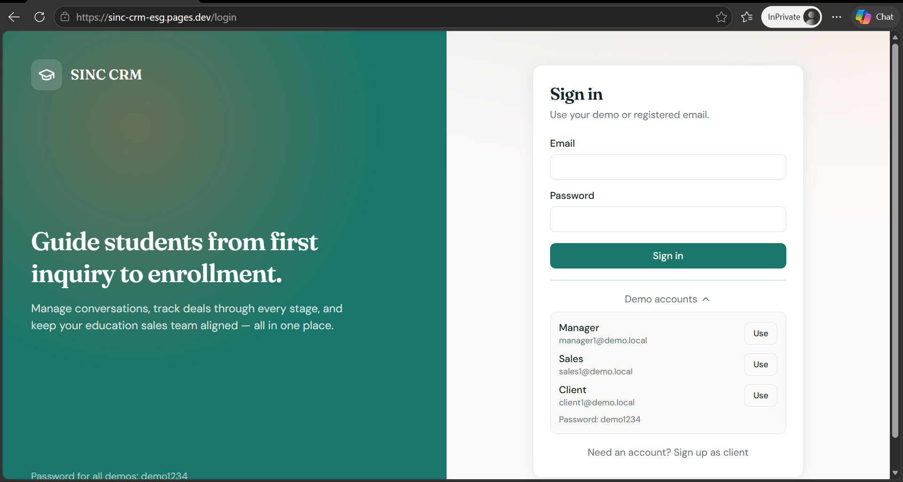
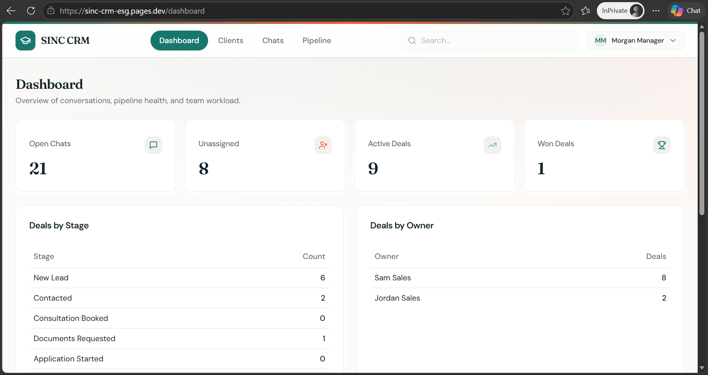
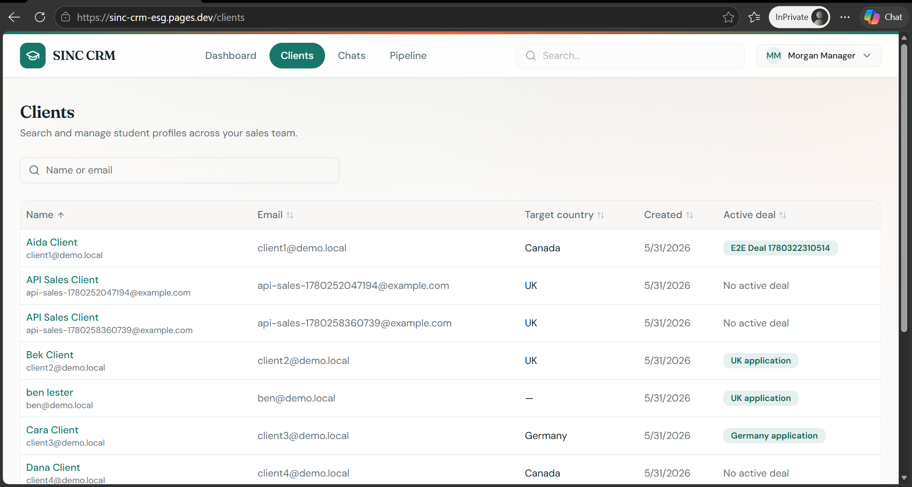
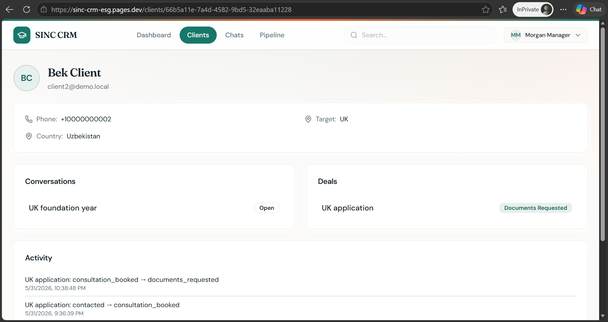
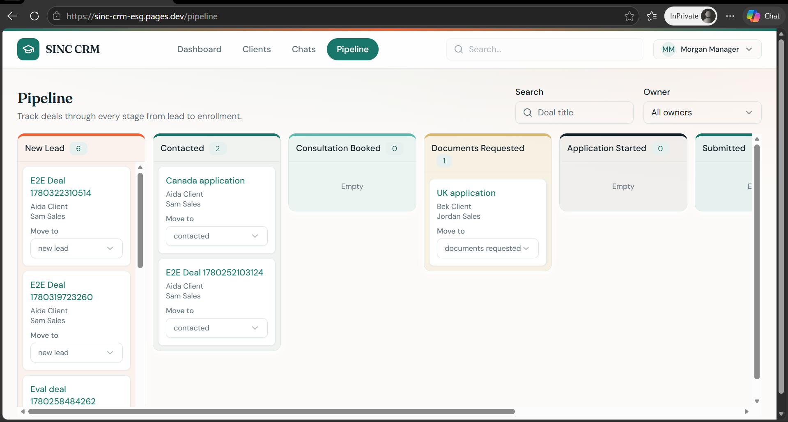
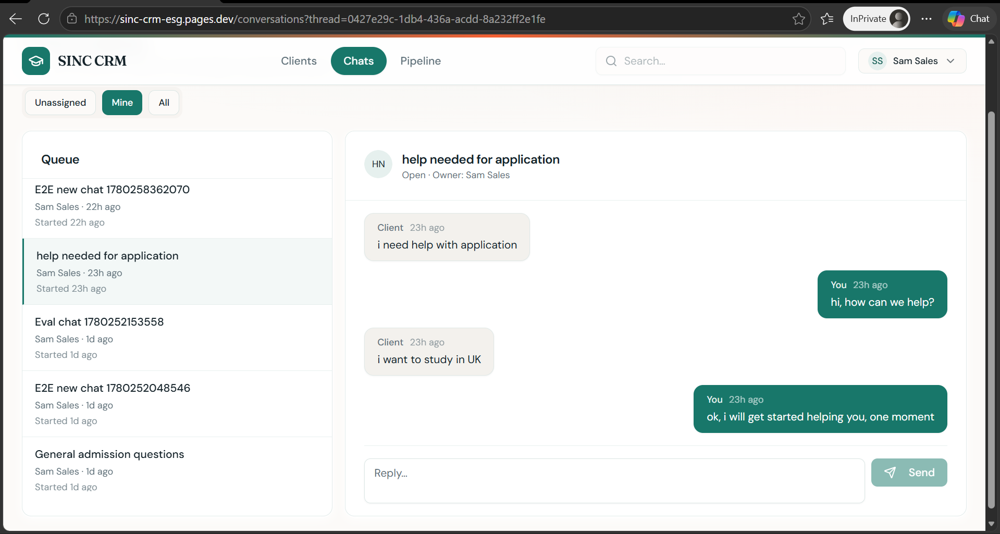
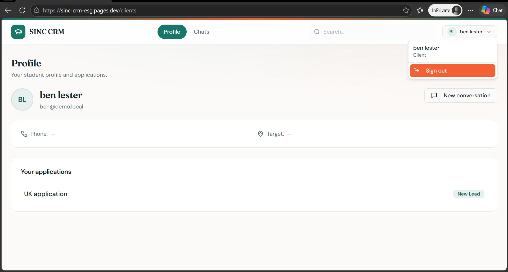
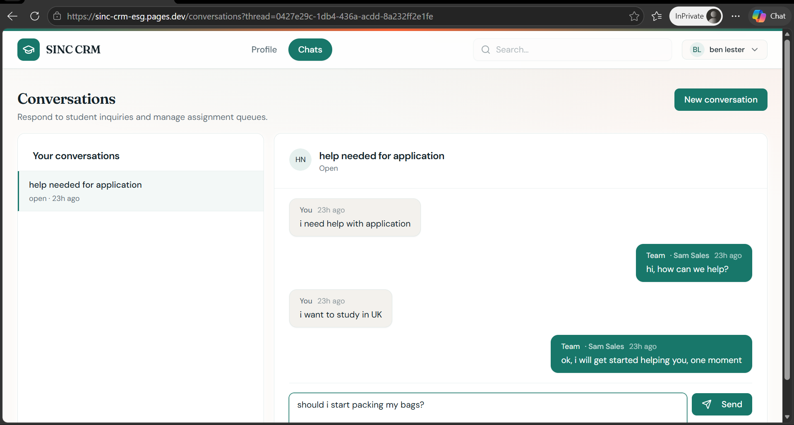

# SINC Student CRM

Full-stack CRM for education agencies placing students abroad. Role-based access, realtime chat, a deal pipeline, and a manager dashboard.

- **SPA:** Cloudflare Pages (Vite + React)
- **API:** Cloudflare Workers (Hono)
- **Data & auth:** hosted Supabase

## Screenshots

| Login |
|-------|
|  |

| Demo accounts |
|---------------|
|  |

**Manager** — dashboard, clients, client detail, pipeline:

| Dashboard | Clients | Client detail | Pipeline |
|-----------|---------|---------------|----------|
|  |  |  |  |

**Sales** — conversation workspace:

**Client** — profile and chat:

| Profile | Chat |
|---------|------|
|  |  |

## Quick start

Canonical guide: [docs/quick-start.md](docs/quick-start.md) — automated setup (Linux/WSL), env files, hosted Supabase schema/seed, and local dev servers.

## Live application

Sign in with any demo user below (password **`demo1234`**), or use the signup form (email verification is disabled for demos).

| Service | URL |
|---------|-----|
| App (Cloudflare Pages) | [https://sinc-crm-esg.pages.dev](https://sinc-crm-esg.pages.dev) |
| API (Cloudflare Worker) | [https://sinc-crm-api.prinxlexter.workers.dev](https://sinc-crm-api.prinxlexter.workers.dev) |

## Demo users

Password for all seeded accounts: **`demo1234`**.

| Role | Email | Display name |
|------|-------|--------------|
| Manager | `manager1@demo.local` | Morgan Manager |
| Manager | `manager2@demo.local` | Alex Manager |
| Sales | `sales1@demo.local` | Sam Sales |
| Sales | `sales2@demo.local` | Jordan Sales |
| Sales | `sales3@demo.local` | Riley Sales |
| Client | `client1@demo.local` | Aida Client |
| Client | `client2@demo.local` | Bek Client |
| Client | `client3@demo.local` | Cara Client |
| Client | `client4@demo.local` | Dana Client |

See [docs/](docs/) for deploy, database setup, and test notes.
