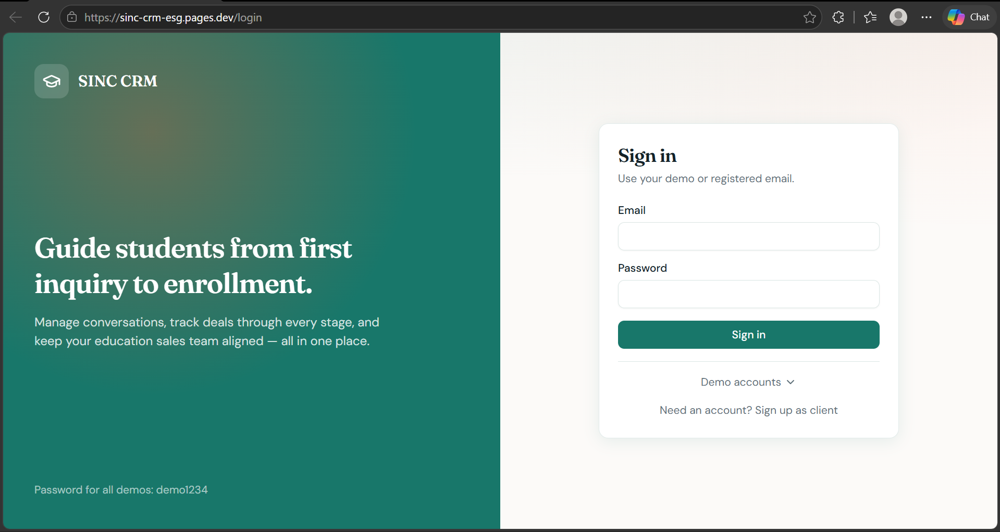
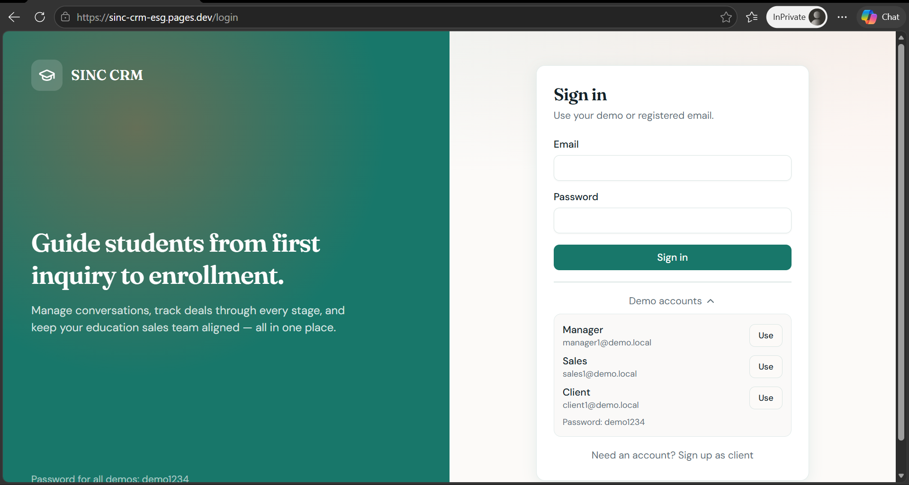
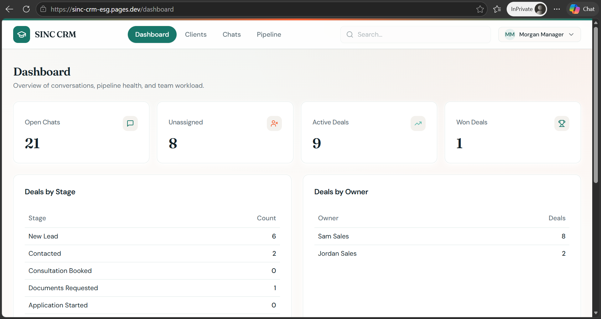
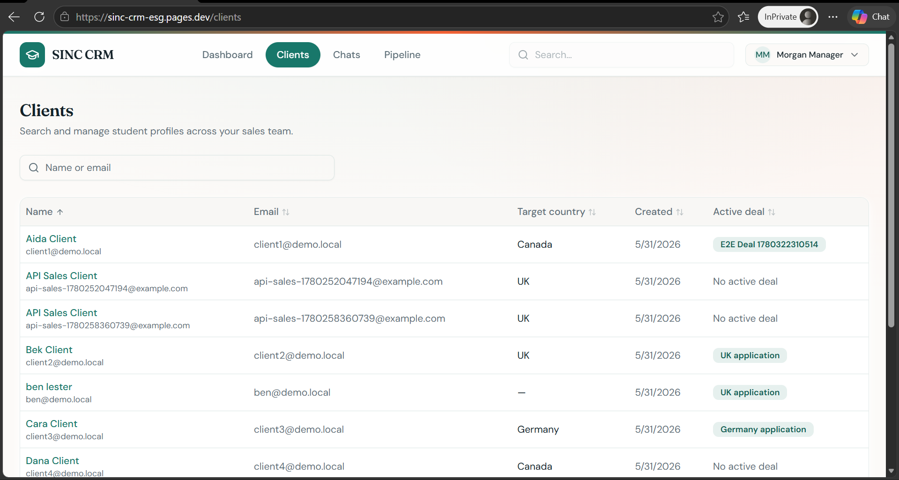
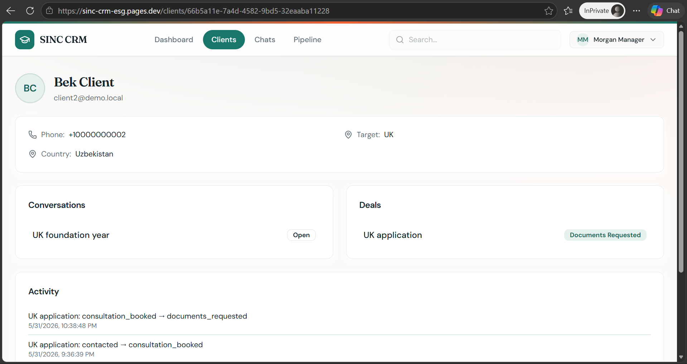
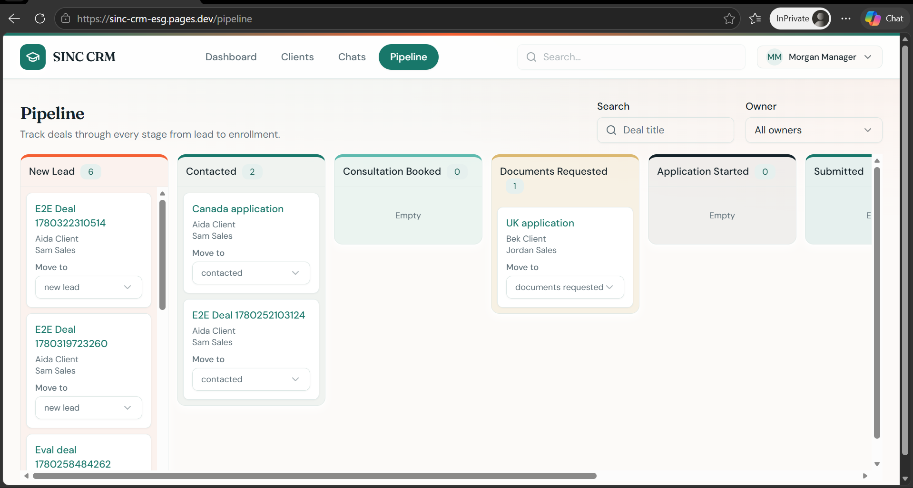
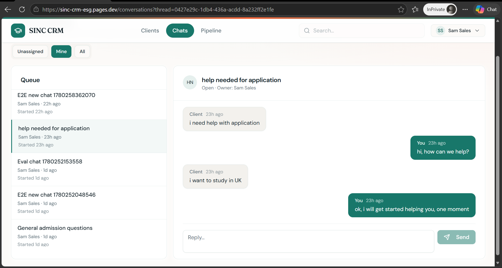
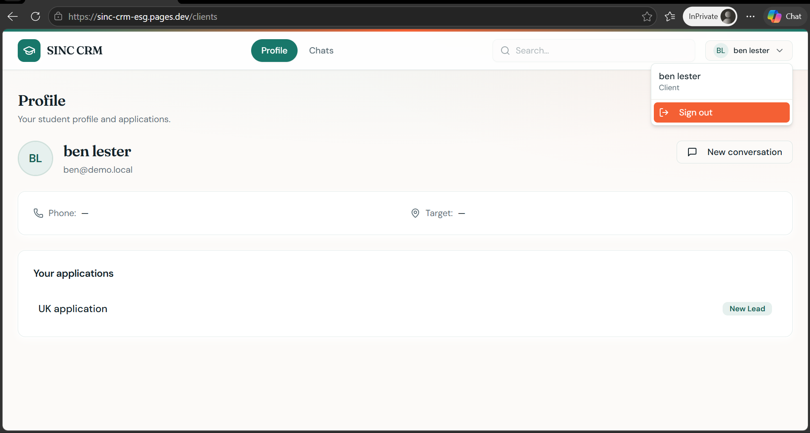
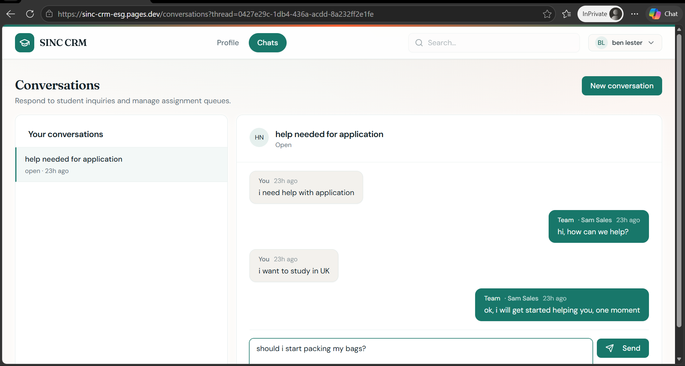

# SINC Student CRM

Full-stack CRM for education agencies placing students abroad. Clients chat with the sales team, sales staff move deals through a pipeline, and managers see the whole picture on a dashboard.

**Live demo:** [sinc-crm.benlester.me](https://sinc-crm.benlester.me) (sign in with a demo account below)

Built by [Ben Lester](https://benlester.me), a software and systems engineer. More of my work: [projects.benlester.me](https://projects.benlester.me).

## What it does

- **Three roles:** manager, sales and client, each with their own screens.
- **Realtime chat** between clients and the sales team.
- **Deal pipeline** with stages, a lost-reason prompt, and an append-only stage history.
- **Manager dashboard** and reassigning of conversations and deals.

## Stack

| Part | Technology |
|------|------------|
| App | Vite, React, TypeScript, shadcn/ui, Tailwind CSS on Cloudflare Pages |
| API | Hono on Cloudflare Workers |
| Data and auth | Supabase (Postgres, Auth, Realtime) |
| Tests | Playwright end-to-end tests, Worker unit tests |

## Screenshots

| Login |
|-------|
|  |

| Demo accounts |
|---------------|
|  |

**Manager** — dashboard, clients, client detail, pipeline:

| Dashboard | Clients | Client detail | Pipeline |
|-----------|---------|---------------|----------|
|  |  |  |  |

**Sales** — conversation workspace:

**Client** — profile and chat:

| Profile | Chat |
|---------|------|
|  |  |

## Quick start

Full guide: [docs/quick-start.md](docs/quick-start.md): automated setup (Linux/WSL), env files, hosted Supabase schema and seed, and local dev servers. More in [docs/](docs/): deploy, database setup, deal lifecycle, security notes, testing.

## Demo accounts

Password for all seeded accounts: **`demo1234`**. You can also use the signup form (email verification is off for the demo).

| Role | Email | Display name |
|------|-------|--------------|
| Manager | `manager1@demo.local` | Morgan Manager |
| Manager | `manager2@demo.local` | Alex Manager |
| Sales | `sales1@demo.local` | Sam Sales |
| Sales | `sales2@demo.local` | Jordan Sales |
| Sales | `sales3@demo.local` | Riley Sales |
| Client | `client1@demo.local` | Aida Client |
| Client | `client2@demo.local` | Bek Client |
| Client | `client3@demo.local` | Cara Client |
| Client | `client4@demo.local` | Dana Client |

## Direct links

| Service | URL |
|---------|-----|
| App | https://sinc-crm.benlester.me |
| API (Cloudflare Worker) | https://sinc-crm-api.prinxlexter.workers.dev |

## License

[MIT](LICENSE) © 2026 Ben Lester.
